# Finlitter — Personal Finance Management Platform

Finlitter is a personal finance management platform designed to help users understand their financial position, track money movement, plan savings goals, and explore potential investment outcomes.

The project combines financial planning tools with backend engineering and security-focused design.

## Demo

Watch the Finlitter demo:

https://github.com/user-attachments/assets/b69cd489-8525-4e34-8d3b-eabd2e016c64
<!-- Keep finlitter.mp4 in the same directory as this Markdown file. -->
<video src="./finlitter.mp4" controls width="100%">
  Your browser does not support embedded video. You can
  [open the Finlitter demo](./finlitter.mp4) instead.
</video>

## Core Features

### Financial Planning
- **Income and Expense Tracking:** Organize income sources and transactions.
- **Net Worth Tracking:** Calculate net worth from assets and liabilities.
- **Budget Planning:** Plan savings toward financial goals.
- **Financial Calculators:** Calculate SIP returns, loan EMIs, compound interest, and fixed deposit maturity.
- **Investment Simulation:** Explore potential portfolio outcomes across equity, debt, and gold allocations using Monte Carlo simulation.

### Security
- Password hashing using Argon2id.
- JWT-based authentication with refresh-token rotation.
- Field-level encryption for sensitive financial data using AES-256-GCM.
- Per-user encryption key derivation using HKDF.
- Rate limiting and refresh-token revocation.

*Security features are documented as design goals; implementation and testing status should be verified before describing them as production-ready.*

## Technology Stack

- **Backend:** Node.js, Express
- **Database and ORM:** PostgreSQL, Prisma
- **Frontend:** React
- **Validation:** Zod
- **Authentication and security:** JWT, Argon2id, AES-256-GCM, HKDF

## System Architecture

Finlitter is a browser-based React application backed by an Express API and PostgreSQL. The diagram shows the current request path, including the separate in-browser investment simulation and the web build workflow.

```mermaid
flowchart LR
  subgraph Browser["WEB CLIENT · apps/web"]
    direction TB
    UI["React interface<br/>TanStack Start · Vite · Tailwind"]
    Pages["Routes and views<br/>Login · Signup · Finance dashboard"]
    Sim["Investment simulator<br/>Client-side · 1,000 paths · Recharts"]
    ClientAPI["API client<br/>fetch · bearer access token · refresh cookie"]
    UI --> Pages
    Pages --> ClientAPI
    Pages --> Sim
  end

  subgraph Server["APPLICATION API · apps/api"]
    direction TB
    Http["Express HTTP layer<br/>JSON · CORS · cookies"]
    Auth["Authentication routes<br/>Signup · Login · Refresh · Logout"]
    Protected["Protected route groups<br/>Accounts · Income · Transactions · Finance"]
    Guard["JWT authentication middleware<br/>Verify token · attach userId"]
    Controllers["Controllers<br/>Request handling and responses"]
    Services["Services<br/>Business rules · dashboard aggregation"]
    Prisma["Prisma Client + PostgreSQL adapter"]
    Http --> Auth
    Http --> Protected
    Protected --> Guard --> Controllers --> Services --> Prisma
    Auth --> Controllers
  end

  subgraph Persistence["DATA STORE"]
    DB[("PostgreSQL<br/>Users · sessions · accounts · transactions<br/>income · investments · loans · budgets · bills")]
  end

  ClientAPI -- "HTTP / JSON<br/>credentials included" --> Http
  Prisma --> DB
  subgraph Delivery["WEB BUILD PIPELINE · GitHub Actions"]
    direction LR
    Trigger["Pull request<br/>or push to main"] --> Checkout["Checkout"] --> Node["Node.js 22"] --> Install["npm ci<br/>apps/web"] --> Build["Vite production build"]
  end

  classDef client fill:#102a43,stroke:#55c2b5,color:#f2f7fa,stroke-width:1.5px
  classDef api fill:#172554,stroke:#7aa2f7,color:#f2f7fa,stroke-width:1.5px
  classDef data fill:#18392f,stroke:#78c99b,color:#f2f7fa,stroke-width:1.5px
  classDef pipeline fill:#332b1b,stroke:#e4b95b,color:#f2f7fa,stroke-width:1.5px
  class UI,Pages,Sim,ClientAPI client
  class Http,Auth,Protected,Guard,Controllers,Services,Prisma api
  class DB data
  class Trigger,Checkout,Node,Install,Build pipeline
```

### Request and data flow

1. The browser renders the route and feature components. The investment simulator generates its projections in the browser and draws the percentile range with Recharts.
2. The API client sends JSON requests to Express. Session restoration posts to `/auth/refresh` with credentials so the browser can send the HTTP-only refresh cookie; protected requests carry the short-lived access token as a bearer token.
3. Express routes authentication requests to the auth controller. Account, income-source, transaction, and finance routes pass through JWT authentication before reaching their controllers.
4. Controllers call service functions for data access and finance calculations. Services use Prisma Client through the PostgreSQL driver adapter.
5. PostgreSQL stores user and finance records. Dashboard responses combine account, income, transaction, loan, investment, budget, bill, and snapshot data for the web client.

### Main API boundaries

| API path | Purpose | Access |
| --- | --- | --- |
| `/auth/*` | Signup, login, refresh, logout | Public routes; refresh and logout use the refresh cookie |
| `/accounts/*` | Account CRUD | JWT required |
| `/income-sources/*` | Recurring income CRUD | JWT required |
| `/transactions/*` | Income and expense transaction CRUD | JWT required |
| `/finance/*` | Dashboard, loans, budgets, bills, and credit score | JWT required |

The GitHub Actions workflow verifies the web production build for pull requests and pushes to `main`; it does not deploy the application. The current Monte Carlo simulator is a client-side feature and does not save simulation inputs or results to the API.

## Investment Simulator

The dashboard includes an interactive, client-side Monte Carlo simulator with allocation sliders, investment horizon, and monthly SIP inputs. Changing an allocation preserves a 100% total. The simulator runs 1,000 monthly paths and shows P10, P50, and P90 values at each year-end, with the P10–P90 range and P50 median on an area chart.

MVP annual assumptions are equity 12% CAGR / 15% volatility, debt 7% / 3%, and gold 8% / 10%. Returns are sampled monthly with a lognormal model; SIP contributions are added at month-end. These are fixed illustrative assumptions, not live historical estimates. Results are simulated scenarios, not guarantees or financial advice.

## Project Status

Finlitter is under active development. The investment simulator MVP is implemented in the web dashboard, and the web production build passes locally. GitHub Actions now installs the web app dependencies and builds the app for pull requests and pushes to `main`.

Planned functionality may change as development and testing progress.

## License

Finlitter is source-available under the **Finlitter Source-Available Non-Commercial License**. See the [`LICENSE`](./LICENSE) file for the complete terms.

The project is available for inspection, learning, educational activities, and permitted non-commercial use. Commercial use, including incorporation into commercial fintech products or services, requires prior written permission from the applicable copyright holders.

Finlitter is source-available, not an OSI-approved open-source project.

Third-party dependencies and components remain subject to their respective licenses.

## Getting Started

The setup instructions will be added once the current database configuration, environment variables, and frontend/backend startup commands have been verified.

## Disclaimer

Finlitter is an educational and personal finance project. Its calculations and investment simulations are not financial advice and should not be treated as guarantees of future performance.
